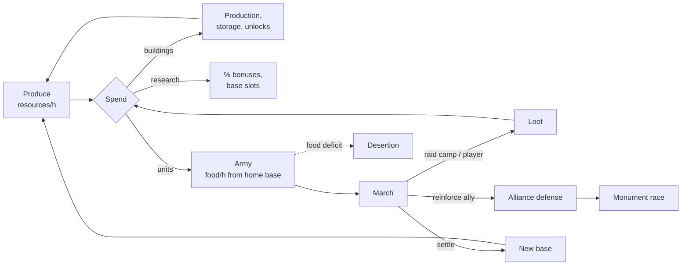
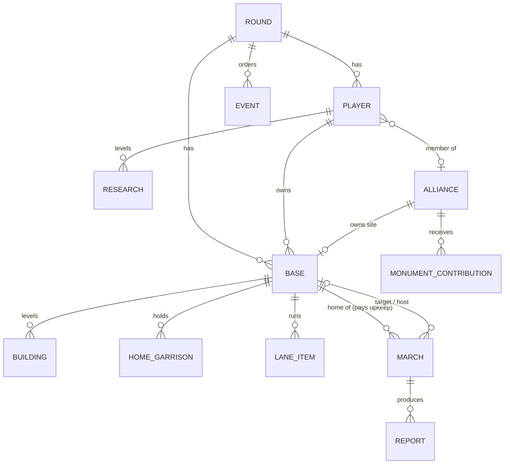
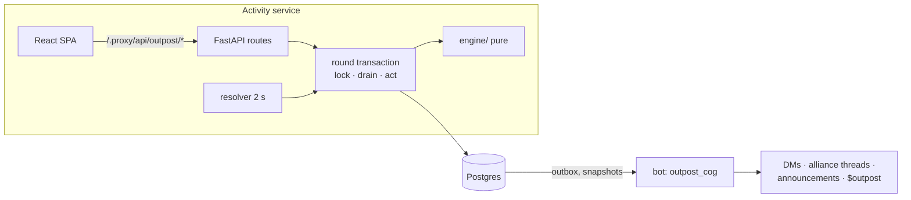

# Outpost — design doc (v3, draft)

Asynchronous, multiplayer base-building strategy game for the Hablemos
Discord server. Lineage: Moonbase (MXit, 2010–2014), Galaxy Wars (MXit /
Android, still live), OGame, Travian, Tribal Wars. *Outpost* is a codename;
every entity name below is a swappable **id** — display names, emoji and
flavor live in a skin file (§8.6), so "quarry / warden / outpost" can become
"cave / tent / house" without touching rules or data.

Status: **Phase 0 built** (engine + simulator in
`activity/backend/app/outpost/`, see `activity/README.md`); not wired into
the Activity yet. v3 incorporates GPT-5.6 adversarial review rounds 1–3
(§16). §11 tables come from the throwaway pre-engine sim; §11.1 has the
first results from the real engine.

---

## 0. TL;DR

- You run 1–4 **bases**. Each produces 3 build resources + 1 upkeep
  resource. You spend them on **buildings**, **research** and **units**.
- Units leave home as **marches** (raid, attack, reinforce, scout,
  transport, settle) with real travel time; combat resolves on arrival,
  deterministically, whether or not anyone is online.
- **Alliances** (cap 8) coordinate through an auto-created Discord thread.
  A **round** lasts 28 days and ends with an alliance **Monument** race;
  then the world resets. Only cosmetic titles carry over.
- Built for a check-in rhythm: ~4 short sessions/day. A 2-slot build queue,
  per-resource vaults, military-strength morale and a **loot bucket**
  guarantee that an undefended night costs at most ~8 h of income.
- Engine: pure functions over state + a globally time-ordered event log;
  each round is one serialized state machine (one advisory lock), which is
  trivially correct at this server's scale (§7).

---

## 1. Design pillars

| # | Pillar | Means | Check |
|---|---|---|---|
| P1 | **Check-in game** | 2–5 min sessions, ~4/day, every session has a decision | Median session ≤ 5 min; ≥ 1 action per session |
| P2 | **Losses sting, never cripple** | No base elimination; bounded **economic** loss | Stock looted from a player (all bases) in any 12 h window ≤ 8 h of their production (by construction, §6.9; sim T4: 7.7 h under hourly raids). Army losses are a choice (you garrisoned) and are not capped. |
| P3 | **Readable math** | Every number explainable in one tooltip; no RNG | Combat deterministic and fixed-point; every report re-computable (§7.7) |
| P4 | **Alliances are the endgame** | Solo viable; winning needs a team | Monument total (8.19 M) > 2× any player's 28-day gross (3.63 M) |
| P5 | **Fresh rounds** | 28-day seasons, full reset | Day-14 joiner ends ≥ 70% of founder economy (sim: 71%) |
| P6 | **Defense is the efficient choice** | Raiding a prepared, active player is unprofitable; camps and inactives are the farm | Sim T4: defended active < 0, camps tier 1–3 > 0 |

P6 is the genre's oldest lesson (OGame/Travian): if raiding active players
is profitable, the game becomes "who is online at 3 AM".

---

## 2. What we borrow, and how we change it

| Mechanic | Source | Our version | Why |
|---|---|---|---|
| Mine cost/production curves | OGame `30·L·1.1^L`/h, cost `base·1.5^(L-1)` ([formulas](https://ogame.fandom.com/wiki/Formulas)) | Same shape + flat base income + hall-gated level caps | Proven feel; caps compress late-joiner gap |
| Build time ∝ cost / (1 + factory) | OGame | `value / (2500·(1+hall))` | Hall is a real choice vs mines |
| Storage curve | OGame `5000·⌊2.5·e^(20L/33)⌋` | ×0.8, max level 12 | OGame's L20 (1.8 B) is absurd at our scale |
| Hidden resources (cranny) | Travian ([cranny](https://support.travian.com/en/articles/35-hiding-resources-and-cranny)) | **Vault** = 10% of store cap, per resource | Small players' whole stock is safe early (sim T4) |
| Upkeep + starvation | Travian crop ([starvation](https://support.travian.com/en/articles/83-starvation-mechanics)); Moonbase helium | Food upkeep paid by the unit's **home base wherever the unit is**; hourly desertion | Soft army cap with no marching/reinforcement loopholes |
| Two attack classes | Travian (def vs infantry / cavalry) | `foot` / `swift` | Composition matters without RPS tables |
| Raid vs attack loss formula | Travian (`(L/W)^1.5`) | Same, K = 1.5, fixed-point | One big wave beats ten small ones (Moonbase guide; sim T4) |
| Morale vs smaller targets | Tribal Wars ([battles](https://help.tribalwars.net/wiki/Battles)) | Own formula on **military strength**, not leaderboard power | Bullying small players is unprofitable; no low-power army accounts |
| Shield after losses | Clash of Clans ([shield](https://clashofclans.fandom.com/wiki/Shield)) | **Loot bucket** — a pre-applied cap, not a shield | No bounce timing exploits; damage bounded before it happens |
| Loot cap 50% exposed | OGame | 50% of stock above vault; food unlootable | Meaningful, never total |
| Barbarian villages / inactives | Tribal Wars, OGame | **Camps**, tiered by ring, batch respawn, world budget | Raiders need targets that aren't newbies |
| Wonder of the World | Travian | Alliance **Monument**, days 18–28, 24 h hold at L10 | Climax, not fade |
| Abandoned land → NPC | Inselnova ([black tide](https://inselnova.com/chronicle/2026-05-23-black-tide/)) | Inactive bases decay into camps | Dead accounts become content |
| Yearly servers | Galaxy Wars | 28-day rounds | Discord attention span |

Rejected: rapid-fire tables (opaque), random combat (disputes), conquering
player bases (elimination kills small communities), pay-to-win.

---

## 3. Decisions

### Locked

| Question | Decision | Basis |
|---|---|---|
| Real-time or turns | Real-time timers | Lineage; check-in friendly |
| Combat randomness | None; fixed-point integer math | P3 |
| Base conquest | Never; raid/siege only | P2 |
| Build queue depth | 2 per base | Sim T1: day 7 economy 3,537 vs 1,741 at depth 1; depth 3 adds ≤ 18% |
| Round length | 28 days; joins close day 21 | T1 growth flattens after day 21; endgame needs a week |
| Alliance cap | 8 (config) | ~60 active → ~8 alliances; Monument needs 53% of 8 members' late output (T7) |
| Concurrency model | One serialized state machine per round (§7.1) | Correct causality by construction; load ≪ capacity |
| Upkeep ownership | Home base pays for its units everywhere | Removes march-banking and reinforcement food-battery exploits |
| Loss cap | Loot bucket (§6.9) | Pre-applied, ungameable timing |
| Rule versioning | Round pins `ruleset_version`; hotfix flag only | Fair, reproducible |
| Accounts | One per Discord user per round | Alt abuse (§10) |

### Open — product calls

| # | Question | Options | Recommendation |
|---|---|---|---|
| D1 | **Primary surface** | (A) Activity web UI + bot for notifications · (B) bot only | **A.** 10 buildings + 3 lanes + map + reports exceed embed/component limits (5 action rows). Activity infra, OAuth and a results poller exist. Bot: DMs, alliance threads, `$outpost` snapshot. |
| D2 | Theme | Five pitched or neutral | Neutral first; theme = skin swap (§8.6) |
| D3 | Spanish hook | Daily *suministro* (+10% production 24 h) · none | Include, capped, never required |
| D4 | Speed | 1.0 · 2.0 (two-week rounds) | 1.0 for beta |
| D5 | Monument hold | 24 h hold at L10 · first to L10 wins | 24 h hold — creates the final war |

---

## 4. Game loop

### 4.1 Four timescales

| Scale | Player does | System does |
|---|---|---|
| **Session** (2–5 min) | Read reports → queue builds → train → send/recall marches → alliance thread | Drains due events; shows timers, threats, idle-lane nudges |
| **Day** (~4 sessions) | Raid camps, scout, plan around targets' sleep, reinforce allies | Resolves marches offline; DMs incoming/results; camps respawn |
| **Week** | Expand, research tiers, alliance politics | Weekly medals reset |
| **Round** (28 d) | Monument race, wars | Day 18 sites spawn; day 21 joins close; day 28 end + archive |

### 4.2 Core flow



### 4.3 First 20 minutes

Churn is front-loaded: one dev log reports most joiners gone after week 1,
with 7% "invested" players producing 59% of play-days
([Inselnova](https://inselnova.com/chronicle/2026-06-20-midgame-players-vanish/)).
The first session must end with a visible win:

1. Spawn with 72 h protection, 600 ore / 600 wood / 100 gem / 300 food.
2. Quest chain, each step pays its own cost back + a bit:
   quarry 2 → sawmill 2 → farm 2 → barracks 1 → train 5 brutes → raid your
   **tutorial camp** → read the report → join or create an alliance.
3. Tutorial camp: private to the player, 1 warden, 1,500 stock, 2 tiles
   away, one-time. Sim T4: 5 brutes win with 0 losses and 300+ loot.
4. First DM: "Your raid returned with 300 loot" — the hook.

---

## 5. Entities

### 5.1 Glossary

| Entity | Definition |
|---|---|
| **Round** | World instance: ruleset version, speed, map, timestamps, status `signup → live → paused ⇄ live → ended`. |
| **Player** | A Discord user's participation in a round: research, alliance, protection/vacation state, scores. |
| **Base** | A tile owned by a player or the NPC faction (`player`, `camp`, `tutorial`, `site`). Stock, buildings, home garrison, lanes. |
| **Tile** | `(x, y)` on a disc of radius `r`. |
| **Resource** | `ore`, `wood`, `gem` (build) + `food` (upkeep). Integer milli-units. |
| **Building** | `(base, type) → level`. |
| **Research** | `(player, tech) → level`. |
| **Unit type** | Static stats in the ruleset. |
| **Home garrison** | Units at their home base: `(base, unit) → count`. |
| **March** | A detachment away from home: owner, **home base**, units, cargo, mission, status `outbound → (stationed) → returning → done`. A reinforcement is a march with status `stationed` at the host. |
| **Lane** | Per-base build lane (2 slots), training lane (1 batch); per-player research lane (1). |
| **Event** | Due-dated state change, processed in global `(due_at, seq)` order. |
| **Report** | Immutable combat/scout/transport record: full inputs, outputs, `ruleset_version`. |
| **Camp** | NPC base by ring tier; full respawn 6 h after last hit. |
| **Monument site** | Endgame tile captured and built by one alliance. |
| **Alliance** | ≤ 8 players; roles; Discord thread; ≤ 1 site. |
| **Notification** | Outbox row the bot delivers once (dedupe key). |

### 5.2 Relationships



---

## 6. Rules (ruleset v1)

Rates per hour at speed 1.0. Round speed `S` is an integer percent
(`100` = 1.0) applied to production, build, training, research, travel.
Level tables (costs, rates, caps) are precomputed integers at ruleset load;
no floating point at runtime (§7.6).

### 6.1 Resources

| id | Role | Producer | Lootable |
|---|---|---|---|
| `ore` | Bulk build | quarry | yes |
| `wood` | Bulk build | sawmill | yes |
| `gem` | Scarce; tier 2–3 units, hall, research | gemworks | yes |
| `food` | Upkeep | farm | **no** |

Trade value: ore 1, wood 1, gem 2.5. Used for scoring, the loot bucket,
siege and cost comparison. There is no NPC exchange in v1.

### 6.2 Buildings

`cost(L) = ⌈base · g^(L-1)⌉` (L-1 → L); `time(L) = value(cost) / (2500 · (1 + hall))` h.
Any non-hall building's level ≤ `2·hall + 5`.

| id | Effect | Base cost o/w/g | g | Max | Requires |
|---|---|---|---|---|---|
| `quarry` | ore `30·L·1.1^L + 30` | 60 / 15 / 0 | 1.5 | 25 | — |
| `sawmill` | wood `25·L·1.1^L + 25` | 48 / 24 / 0 | 1.6 | 25 | — |
| `gemworks` | gem `10·L·1.1^L + 5` | 225 / 75 / 0 | 1.5 | 25 | hall 1 |
| `farm` | food `25·L·1.1^L + 20` | 75 / 30 / 0 | 1.5 | 25 | — |
| `hall` | build time `÷(1+L)` | 200 / 120 / 60 | 1.75 | 15 | — |
| `store` | cap/resource `4000·⌊2.5·e^(20L/33)⌋`; vault = 10% of cap | 500 / 250 / 0 | 1.8 | 12 | — |
| `barracks` | training; tiers at 1/5/10; time `÷(1 + 0.1·L)` | 200 / 100 / 0 | 1.6 | 20 | hall 1 |
| `wall` | `D = (D_units + 50·L)·(1 + 0.04·L)` | 150 / 200 / 0 | 1.6 | 20 | barracks 1 |
| `tower` | incoming intel (§6.10) | 100 / 150 / 50 | 1.7 | 10 | hall 3 |
| `lab` | research speed; tech level ≤ lab level | 200 / 400 / 200 | 1.8 | 15 | hall 3 |

Store levels: L0 8 k / vault 800 · L2 32 k / 3.2 k · L4 112 k / 11.2 k ·
L6 376 k / 37.6 k · L12 14.4 M / 1.44 M.

### 6.3 Units

| id | Tier | Cost o/w/g | Food/h | Atk | Class | Def vs foot | Def vs swift | Speed | Cargo | Train |
|---|---|---|---|---|---|---|---|---|---|---|
| `warden` | 1 | 50/40/0 | 1 | 10 | foot | 40 | 50 | 6 | 15 | 3m |
| `brute` | 1 | 70/30/0 | 1 | 40 | foot | 15 | 10 | 6 | 40 | 3.5m |
| `scout` | 1 | 40/40/10 | 1 | 0 | — | 2 | 2 | 18 | 0 | 2m |
| `outrider` | 2 | 120/100/20 | 2 | 55 | swift | 20 | 25 | 14 | 110 | 7m |
| `bulwark` | 2 | 140/160/60 | 1 | 10 | foot | 130 | 110 | 5 | 0 | 10m |
| `lancer` | 3 | 260/180/120 | 2 | 200 | swift | 50 | 30 | 10 | 60 | 15m |
| `hauler` | 2 | 90/110/0 | 1 | 0 | — | 5 | 5 | 9 | 600 | 5m |
| `ram` | 3 | 300/400/100 | 3 | 30 | foot | 30 | 30 | 4 | 0 | 30m |
| `settler` | 3 | 4000/4000/2000 | 5 | 0 | — | 10 | 10 | 5 | 0 | 2h |

**Role per combat unit** (sim T3): warden leads defense per resource vs
both classes; brute leads attack per resource; outrider leads speed among
fighters and raid cargo (41 cargo/100 value at speed 14); bulwark leads
defense per food (130 vs foot); lancer leads attack per food (100) and per
training hour. Utility units: scout (fastest, intel), hauler (300 cargo/100
value), ram (siege), settler (expansion). Tier 1 is cheap per resource;
tier 2–3 are cheap per **food**, the late-game army cap — the reason to
climb tiers.

### 6.4 Research (player-wide; one at a time)

`cost(L) = ⌈base · g^(L-1)⌉`; time `value / (1000 · (1 + lab))` h, `lab` of the
base that started it.

| id | Per level | Base cost o/w/g | g | Max |
|---|---|---|---|---|
| `arms` | attack +3% | 300 / 500 / 200 | 1.8 | 10 |
| `armor` | defense +3% | 500 / 300 / 200 | 1.8 | 10 |
| `logistics` | speed +5%, cargo +5%, +1 march slot per 2 levels | 400 / 400 / 100 | 1.8 | 10 |
| `agronomy` | food +5% | 300 / 300 / 100 | 1.8 | 10 |
| `industry` | ore/wood/gem +3% | 500 / 500 / 250 | 1.8 | 10 |
| `espionage` | scout strength +15% | 200 / 300 / 100 | 1.8 | 10 |
| `charter` | +1 base slot | 4000 / 4000 / 2000 | 3.0 | 3 |

### 6.5 Upkeep and starvation

- A base's food rate = farm output − upkeep of **every unit whose home is
  this base**, wherever it is: home, marching, or stationed. Hosting a
  reinforcement costs the host nothing.
- When stock hits 0 with net < 0 the base is **starving**. At each full
  hour starving, units desert until the hourly deficit is covered,
  chosen across **all** of the base's units regardless of location:
  largest upkeep-weighted stack first, ties by `(unit, location id)`.
  Marching units desert in transit. A march's cargo is then capped to the
  survivors' cargo capacity: the excess is lost, removed proportionally per
  resource (floor, remainder by resource id). A march left with no units
  vanishes with its cargo. Location therefore never shelters an army.
- Buildings never collapse (P2).
- `starvation_warning` at projected ≤ 6 h; the engine schedules a
  `starve_check` event at the projected zero time (§7.3).

### 6.6 Travel, march slots, recall

- `travel = distance / (slowest_speed · (1 + 0.05·logistics))`, min 5 min.
  Euclidean distance on a **disc** of radius `r = ⌈4·√players_at_start⌉`.
- Sim T5 (N = 60, r = 31): neighbors 3–8 tiles = 13–34 min outrider,
  30–80 min brute; edge → center 2.2 h outrider, 7.8 h ram; diameter
  4.4 h outrider, 15.5 h ram.
- **March slots:** concurrent outbound + returning marches per player =
  `3 + ⌊logistics / 2⌋` (max 8). Stationed reinforcements do not use a slot;
  a detachment recalled or dismissed while all slots are busy still
  returns (slots may be exceeded only by forced returns).
- **Per-target cap:** ≤ 3 concurrent hostile marches from one player to one
  base.
- **Recall:** allowed while outbound; the march turns around at that
  moment and returns in the time already elapsed. Stationed detachments
  can be recalled by the owner or dismissed by the host at any time.
- **Affiliation and vacation are snapshotted at launch** (§6.11, §6.14): a
  march legal at launch resolves on arrival.

### 6.7 Combat

Snapshot at **arrival**: units, research, wall, morale. (Affiliation and
vacation legality are checked at launch, §6.6.)

```
A_foot, A_swift = Σ atk·n per class
A      = (A_foot + A_swift) · (1 + 0.03·arms_attacker) · morale
mix_f  = A_foot / (A_foot + A_swift)
D_units = Σ over stacks s: n_s · (def_foot·mix_f + def_swift·(1 − mix_f)) · (1 + 0.03·armor_owner(s))
D      = (D_units + 50·wall) · (1 + 0.04·wall)

A > D:  attacker wins, x = (D/A)^1.5
A ≤ D:  defender wins, x = (A/D)^1.5      (ties → defender)
attack: winner loses fraction x, loser loses all
raid:   winner loses x/(1+x), loser loses 1/(1+x)
```

- Missions with `A = 0` (no attack units) are rejected at launch;
  scouts use §6.10.
- A tie in attack mode (`x = 1`) annihilates both sides; in raid mode both
  lose 50%. Intended and documented in the report.
- **Casualties:** compute each side's total loss once
  (`⌈total·frac⌉` for the loser, `⌊total·frac⌋` for the winner), then
  apportion across all stacks (owners × unit types) by largest remainder,
  ties by `(owner_id, unit)`. No per-stack rounding exploit.
- All ratios in fixed point `Q = 10⁹`; `^1.5` via `r·isqrt(r·Q)/Q`.
- Superlinear K = 1.5 (sim T4): 250 brutes in one wave beat 60 bulwarks;
  the same 250 in ten waves of 25 all die and leave 35 bulwarks.

**Raid vs attack**

| | Raid | Attack |
|---|---|---|
| Losses | Partial both sides | Loser wiped |
| Loot | Yes (cargo, bucket) | Yes (cargo, bucket) |
| Rams | Ignored (not consumed) | Applied (§6.7.1) |
| Monument site | Not allowed | Required to capture/siege |
| Ends sender's beginner protection | Yes, if target is a player | Yes |

#### 6.7.1 Siege

Rams are **consumed** after a won attack. Siege value = surviving rams ×
ram value (950). Wall: remove top levels while siege value ≥ that level's
cost value, max 3 levels per battle. Monument: same at 0.5× (rams count
half), max 1 level per battle. Rams on a lost attack die with the army.
Siege trades value roughly 1:1 — destroying is never cheaper than
building.

### 6.8 Morale (attacks on players only)

`military(p) = power(p) + value(all units owned by p, anywhere) / 1000`
(a size measure, deliberately including economy: morale protects small
*players*, not small armies).
`r = max(military_def, 10) / max(military_att, 10)`;
`morale = clamp(0.3 + 1.4·r, 0.3, 1.0)`.
Full strength vs anyone ≥ 50% of your military; 0.58 at 20%; 0.44 at 10%.
Not applied to camps/sites, or when the defender attacked the attacker in
the last 24 h (revenge is full strength). Military is private; the launch
screen shows a **band** (100% · 75–99% · 50–74% · 30–49%), and the exact
value appears only in the post-battle report.

### 6.9 Loot, vault, loot bucket

- **Exposed stock:** per build resource `e_r = ⌊max(0, stock_r − vault) / 2⌋`
  (food excluded).
- **Loot bucket** — **player-wide**, across all bases: capacity
  `B = 4 × the player's total hourly production value` (ore + wood +
  2.5·gem, all bases), refilling at `B / 12` per hour, starting full.
  Any 12 h window therefore loses at most `B + 12·B/12 = 2B = 8 h` of
  production. Capacity is recomputed whenever the player's production
  changes; fill is clamped to the new capacity. A player-wide bucket closes
  the warehouse-base exploit (stockpiling in a low-production base).
- **Allocation** (deterministic, integer): with surviving cargo `C` (units)
  and bucket fill `F` (value),
  `f = min(1, C / Σe_r, F / Σ value_r·e_r)` in fixed point;
  `loot_r = ⌊f · e_r⌋`. The bucket drops by `Σ value_r · loot_r`.
- Same-instant arrivals resolve in `(due_at, seq)` order: the earlier
  launch gets first claim on the bucket.
- The bucket has **no exemptions**: every loot debits it, whoever the
  raider. Friends can't launder because affiliated combat is banned for 7
  days after sharing an alliance (§6.14); a bucket drained by anyone still
  protects the defender — that is the point.
- Vacation freezes bucket capacity and fill at their pre-vacation values.
- Sim T4 (day-14 player, 5,758/h, `B` = 23 k): raided every hour for 12 h by
  20 k-value parties → 12.1 k, 12.3 k, then ~1.9 k per hit; 44.1 k total =
  7.7 h of production.

### 6.10 Scouting and intel

- Scout succeeds if `scouts_a · (1 + 0.15·esp_a) > scouts_d · (1 + 0.15·esp_d)`.
  Defender loses scouts by the raid formula on scout counts; failed
  scouts all die. Success reveals stock, home garrison, stationed
  detachments, buildings. Defender is always notified.
- Incoming hostile marches are visible at launch with ETA; `tower` level:
  1 = mission, 4 = unit types, 7 = counts ±20%, 10 = exact.
- Fakes (1-unit hostile marches) are legal: they cost a march slot, the
  unit's upkeep and count against the per-target cap. Notifications
  aggregate per base per 10 min.

### 6.11 Protection, vacation, inactivity

| State | Rule |
|---|---|
| **Beginner protection** | 72 h from join. Cannot be attacked or scouted by players. Can raid camps. Ends early when the player launches a hostile march at a player. While protected: cannot host reinforcements, cannot send transports to other players, can receive ≤ 1 h of own production per 24 h in alliance transports. |
| **Vacation** | See state table below. |
| **Inactive** | See state table below. |

**Inactivity state machine**

| From | Event | To | Effects |
|---|---|---|---|
| active | 72 h without a session | inactive | Map flag; morale ignored against them; everything else unchanged |
| inactive | any session | active | Flag cleared; nothing lost |
| inactive | 7 days without a session | gone | Bases convert to camps (§6.12 budget); own marches and detachments disband; guests at their bases return home; alliance membership ends |
| gone | any session | gone | Read-only view of the round; cannot rejoin until the next round |

**Vacation state machine**

| From | Event | To | Effects |
|---|---|---|---|
| none | request (no hostile launch in last 12 h; quota left) | pending | Cannot launch hostile marches; can cancel |
| pending | cancel | none | 24 h before the next request |
| pending | 12 h elapsed | active | Production stops; bucket frozen; own outbound marches recall; guest detachments sent home; no actions |
| active | ≥ 48 h and player exits, or quota exhausted | none | Production resumes; 24 h before the next request |

Hostile marches **launched before the request** resolve on arrival in
any state. Marches launched after the request are rejected at launch
(`target_on_vacation`). Quota 14 days/round.

### 6.12 Camps (PvE)

- **Rings:** tile at distance `d` from center is tier
  `t = 5 − ⌊5·d / (r+1)⌋` (center 5 … outer 1).
- Tier `t`: stock `6000·2^(t-1)` value split evenly by value across
  ore/wood/gem; garrison `8·2^(t-1)` wardens, plus `2^(t-1)` bulwarks for
  `t ≥ 3`.
- **Batch respawn:** a camp keeps its damage and fully restores stock and
  garrison 6 h after the **first** battle since it was last full (later
  hits don't extend the timer → no respawn denial).
- **World budget:** `⌈0.5 · active players⌉` camps, rebalanced daily by
  ring. Converted inactive bases count toward the budget; when over
  budget, the oldest converted camps are removed. Max supply (every camp
  farmed every 6 h) ≈ 250–4,000 value/player/h by tier; typical mix ≈
  1,000/h ≈ 28% of day-7 production — a supplement, not the economy.
- Sim T4 with a 20 k party: tiers 1–3 profitable (+2.6 k to +5.0 k);
  tier 4 −2.3 k; tier 5 lost. Tier progression needs bigger armies.
- **Tutorial camp:** spawned at join, `kind = tutorial`, `owner_id` = the
  player (only they can target it), 1 warden, 500 ore / 500 wood / 200 gem.
  Despawns after the first won raid or at 72 h; a lost raid respawns it
  after 1 h.

### 6.13 Expansion

- Base slots = `1 + charter` (max 4). A `settler` march **reserves a slot
  at launch**; recall or failure releases it.
- Target: empty tile ≥ 3 tiles from any base, re-checked on arrival. If
  taken or now too close, the settler returns home (slot released).
  Simultaneous arrivals: first in event order wins.
- New base: quarry/sawmill/farm 1, 500 of each build resource, own lanes
  and garrison; research is shared.

### 6.14 Alliances

- Cap 8. Roles: leader (disband, promote, transfer), officer (invite,
  kick), member. Invitation must be accepted.
- **Affiliated combat banned:** no hostile marches between players who are
  in the same alliance or shared one in the last **7 days**. Checked
  at launch only: a march legal at launch resolves even if the players
  become affiliated in flight (joining an attacker's alliance is no
  shield).
- Leaving/kicked: 24 h before joining another alliance. Departing
  members' detachments at former allies return home immediately.
- **Reinforcement:** requires the host's alliance membership at arrival;
  host may dismiss any detachment. Detachments defend with the host's
  wall; casualties apportioned as §6.7.
- **Transports:** haulers to own bases or alliance members only. Cargo in
  transit is safe but costs upkeep and march slots. Non-alliance transfers
  do not exist.
- The bot opens a private thread per alliance and syncs membership.

### 6.15 Endgame: Monument race

- **Day 18:** sites spawn in the center ring, one per two **qualified**
  alliances (≥ 3 non-inactive members at day 17 00:00), rounded up — shell
  alliances don't add sites. Garrison: 256 wardens + 32 bulwarks (camp
  formula at tier 6), no respawn.
- Capture: won attack-mode battle by a member of an alliance that holds no
  site, which also clears any stationed defenders.
- Levels 1–10, cost `⌈150,000 · 1.35^(L-1)⌉` value, checked in as an
  integer table: 150,000 · 202,500 · 273,376 · 369,057 · 498,226 ·
  672,606 · 908,017 · 1,225,823 · 1,654,861 · 2,234,062 (total 8,188,528).
  Recipe 40% / 40% / 20% of value as ore / wood / gem, each share rounded
  up to whole units. A level is funded when **each** resource meets its
  share; excess of one resource doesn't substitute for another.
- Members contribute via transport marches. When funded, the level builds
  for 6 h; one at a time.

**Monument site state machine** (all transitions in event order)

| State | Event | Result |
|---|---|---|
| npc | won attack by eligible alliance | owned(L0) |
| owned(L) | contributions fund level L+1 | building(L→L+1), ends in 6 h |
| building | 6 h elapsed | owned(L+1); at L10 start 24 h hold |
| owned / building | won attack-mode battle by a member of an alliance **holding no site** | **Capture.** Owner changes; level −1, and −1 more if surviving rams' siege value (§6.7.1, 0.5×) covers the new top level (max −2); rams consumed; in-progress build and unfunded contributions destroyed; hold reset |
| owned / building | won attack-mode battle by a member of an enemy alliance that **already holds a site** | **Siege only.** Owner unchanged; level −1 if surviving rams' siege value covers the top level (max −1); rams consumed; in-progress build destroyed; unfunded contributions kept; hold reset |
| owned / building | lost attack, or any raid | No change (raids on sites are rejected at launch) |
| owned(L10) holding | 24 h elapsed | owner wins the round |

A won attack-mode battle always wipes the defenders (§6.7), so exactly one
of the two transitions applies, chosen by whether the attacker's alliance
already holds a site. Capturing a nearly finished site costs the attacker
at least one level and all pending contributions, so building beats
waiting to steal.

- Totals (sim T7): 8.19 M cumulative; L10 alone 2.23 M. Share of members'
  days 18–28 gross (264 h) needed: 8 → 49%, 6 → 65%, 4 → 98% (small
  alliances must save earlier).
- **Win:** hold L10 for 24 h. If nobody completes a hold, highest level at
  round end wins; ties by earliest `level_reached_at`, then event order.

### 6.16 Score and leaderboards

- **Power** = value spent on buildings + research ÷ 1000 (public).
- **Military** (§6.8) is private, used only for morale.
- Weekly boards, reset Monday 00:00 UTC, medals into the Hall of Fame:
  Raider (loot value), Attacker (enemy value destroyed attacking),
  Defender (enemy value destroyed defending), Builder (power gained).
  Affiliated combat is impossible within 7 days of sharing an alliance
  (§6.14), so medals can't be farmed between friends.

### 6.17 Late joiners

- Spawn in the outer ring near other recent joiners; joins close day 21.
- **Head start** (`headstart_pct` = 10): a player joining after day 1
  starts with each building at the 10th-percentile level among active
  players' first bases, clamped to the seeded hall's cap. Seeded levels
  count toward power. Starting stock is ×`(1 + round_day/7)`.
- **Cohort boards** (`cohort_boards` = 1): next to the server-wide board,
  every player sees a board of everyone who joined in the same round
  week, and that is the board a newcomer sees first. Weekly medals are
  awarded per cohort as well as server-wide.
- The old 5-day production boost (`catchup_max_pct`) is off by default:
  combined with a head start it overshoots (late joiners end at
  1.6–1.7× founders).
- Results: §11.1, "New joiners".

### 6.18 Round timeline

All times UTC. `day N` = `[starts_at + (N−1)·24 h, starts_at + N·24 h)`.
Signup opens 3 days before. Day 18 sites spawn; day 21 joins close.
**Round end is a barrier, not an event:** at `ends_at`, drain processes
every event with `due_at ≤ ends_at` regardless of `seq`, then the end
handler computes the winner and freezes the round. Pause does not stop the
game clock; long pauses are compensated by an admin extending `ends_at`.

---

## 7. Engine

### 7.1 One serialized state machine per round

Every mutation of round `R` — player action, due events, admin command —
runs in one transaction holding `pg_advisory_xact_lock(outpost_key(R))`:

```
BEGIN
  SET LOCAL lock_timeout = '2s'      -- requests; the resolver waits longer
  lock round R
  now = clock_timestamp()            -- taken after the lock
  backlog = drain(R, now, max=500)   -- §7.2
  if backlog remains and this is a player request:
      ROLLBACK → 503 "catching up", Retry-After 2
  apply action at now (if any)       -- pure engine fn
  persist state deltas, new events, reports, outbox, action record
COMMIT
```

Why: per-aggregate locking was causally wrong (an arrival processed after
its origin was settled past the return time; events inserted into a
settled past). One lock per round makes order total and trivial. Capacity:
a mutation is a few ms; 60 players produce < 2 mutations/s at peak against
a > 100/s ceiling. Drain is **bounded** (500 events per transaction) so a
backlog after downtime never produces one huge transaction: the resolver
catches up in batches while requests get a fast 503 instead of queueing on
the lock. Escape hatch if a round outgrows one lock: shard by map region
with cross-shard march handoff — not needed for this server.

### 7.2 `drain(R, until)`

```
loop:
  ev = next pending event in R with due_at ≤ until, order (due_at, seq)
  if none: break
  for each base whose rates the event changes or reads:
      settle(base, ev.due_at)        -- closed-form production/upkeep/clamp
  apply(ev)                          -- may emit events with due_at ≥ ev.due_at
  mark ev done
```

- `seq` is a per-round monotone counter assigned at insert, so same-instant
  events order by creation. Emitted events always have `due_at ≥` the
  current event's (asserted).
- Actions are applied after all events due ≤ `now`, so an action never
  acts on stale state. A due event never runs after a later action.
- Resolver loop (Activity service): every 2 s, a transaction with
  `until = now` and no action — keeps notifications timely. Player
  requests also drain, so a stalled resolver delays DMs, never
  correctness.
- Lag metric `now − min(due_at pending)`; alert > 60 s.

### 7.3 Settle

`settle(base, t)` integrates from `base.settled_at` to `t`: production at
fixed rates, clamped at cap per resource; food at net rate clamped at 0.
Rates only change inside events/actions, which always settle first, so the
interval is linear. Starvation is an event: whenever a base's food rate or
stock changes, the engine (re)schedules `starve_check` at the projected
zero time, tagged with the base's `rate_version`; stale checks no-op.
Lazy camp respawn: one `camp_respawn` event 6 h after the first battle on a
full camp; later battles don't reschedule it (§6.12).

### 7.4 Events

| Kind | Effect |
|---|---|
| `build_done`, `research_done` | Level up; next lane item starts |
| `train_batch_done` | Units added to home garrison (one event per batch) |
| `march_arrive` | Mission resolution at target (combat, transport, reinforce, settle, contribute, bounce) |
| `march_return` | Units + cargo join home |
| `starve_check` | Hourly desertion step |
| `camp_respawn` | Restore camp |
| `bucket` | None — bucket fill is closed-form like production |
| `vacation_activate`, `protection_end` | State transitions |
| `monument_level_done`, `monument_hold_done` | Endgame |
| `round_phase` | Day 18 spawn, day 21 close (round end is a barrier, §6.18) |

### 7.5 Actions and idempotency

`action(state, rules, now, params) → Accepted(deltas, events) | Rejected(code)`.
Codes (`insufficient:ore`, `lane_full`, `protected_target`,
`affiliated_target`, `no_march_slot`, …) map to friendly copy. Requests
carry a client `nonce`; `outpost_actions` stores `(player, nonce)`,
`request_hash`, status and the response. A replay returns the stored
response; same nonce with a different hash → `409`.

### 7.6 Numbers

One canonical rule: **all runtime math is integer**; every division states
its rounding.

| Quantity | Representation | Rounding |
|---|---|---|
| Stock | milli-units `BIGINT` per resource | — |
| Level tables (cost, rate, cap, vault, monument) | Generated once by a script from §6 formulas, checked into `rules/v1.py` as integers | Costs ⌈⌉, rates and caps ⌊⌋ at generation; runtime never calls `exp`/`pow` |
| Production | rate in milli-units/h; persisted residual `res_r` in milli·ms per resource | `produced = (rate·Δms + res_r) // 3_600_000`, `res_r = (…) % 3_600_000`; residual zeroed when clamped at cap. Settle frequency never changes output. |
| Speed | integer percent | multiply first, divide last |
| Durations | integer ms | build/train/research/travel ⌈⌉ |
| Distance | `isqrt((dx²+dy²)·10⁶)` → milli-tiles | ⌊⌋ |
| Combat ratios, morale, loot fraction | fixed point `Q = 10⁹`; `^1.5` as `r·isqrt(r·Q)/Q` | ⌊⌋; casualties per §6.7 |
| Bucket | milli-value; refill residual like production | as production |

The ruleset is pure data; `ruleset_version` is a content hash of the
generated tables.

### 7.7 Reports and replay

A report stores every combat input (both sides' stacks with owners,
research, wall, morale, mission, stock, vault, bucket) and outputs. An
admin tool re-runs `combat.resolve` on the inputs and diffs (P3).

### 7.8 Failure handling

- `apply` runs inside a `SAVEPOINT` within the round transaction. On an
  exception: roll back to the savepoint, increment the event's `attempts`,
  store the error, and commit — **while still holding the round lock**, so
  no other worker can retry concurrently.
- After 3 attempts the round goes `paused`: drain stops and player actions
  are rejected with a maintenance message; an admin alert goes to the
  outbox. The resolver keeps running in paused mode **only** to execute
  admin commands (`skip <event>`, `resume`). Correctness over
  availability: skipping silently would corrupt the world; a
  deterministic bug would recur forever.
- Outpost routes return 503 when the Activity has no database (it can run
  without one today, `main.py` lifespan).

---

## 8. Architecture

### 8.1 Surfaces (assuming D1 = A)



- The Activity backend is the **only writer** of game state.
- The bot claims `outpost_notifications` with a lease (`claim_token`,
  `lease_until`; `UPDATE … WHERE sent_at IS NULL AND (lease_until IS NULL OR
  lease_until < now())`), delivers, then marks sent with a CAS on its own
  token. Delivery is **at-least-once**: a crash between send and mark can
  duplicate one message; `dedupe_key` stops duplicate *rows*, not Discord
  re-sends. Syncs alliance threads from
  `outpost_alliance_members.thread_synced_at`; serves `$outpost` from
  `outpost_base_snapshots` (stock at `settled_at`, rates, caps) projected
  linearly with an "as of" footer. Display only.
- Admin commands (`$outpostadmin pause|resume|skip|ban`) write an
  `outpost_admin_commands` row the Activity resolver executes inside the
  round transaction — the bot never mutates game state.

### 8.2 Modules

```
activity/backend/app/outpost/
  rules/   model.py · v1.py · skin.py
  engine/  state.py · economy.py · combat.py · marches.py · protection.py
           alliance.py · monument.py · actions.py · drain.py
  store.py      asyncpg: load/lock/persist; the only SQL in the feature
  worker.py     resolver, admin-command executor, lag metric
  routes.py     state, actions, map, reports, alliance
  sim/          agents × engine → §11 tables (imports engine; no copies)
activity/frontend/src/games/outpost/
cogs/outpost_cog/   main.py (outbox, threads, $outpost) · admin.py
```

### 8.3 Auth and eligibility

Activity OAuth identifies the user (`discord_oauth.py`). Joining a round
requires guild membership and either ≥ 7 days in the server before the
round starts or a configured member role. Per-user rate limit 30
actions/min.

### 8.4 Data model (Activity schema, `activity/backend/app/db.py`)

```sql
CREATE TABLE IF NOT EXISTS outpost_rounds (
  id SERIAL PRIMARY KEY, ruleset_version TEXT NOT NULL, speed_pct INT NOT NULL,
  map_radius INT NOT NULL, starts_at TIMESTAMPTZ NOT NULL, joins_close_at TIMESTAMPTZ NOT NULL,
  ends_at TIMESTAMPTZ NOT NULL, status TEXT NOT NULL,          -- signup|live|paused|ended
  event_seq BIGINT NOT NULL DEFAULT 0, paused_reason TEXT);
CREATE TABLE IF NOT EXISTS outpost_players (
  round_id INT NOT NULL REFERENCES outpost_rounds, user_id BIGINT NOT NULL,
  joined_at TIMESTAMPTZ NOT NULL, protection_until TIMESTAMPTZ NOT NULL,
  vacation_state TEXT NOT NULL DEFAULT 'none',                 -- none|pending|active
  vacation_at TIMESTAMPTZ, vacation_cooldown_until TIMESTAMPTZ, vacation_used_s INT NOT NULL DEFAULT 0,
  last_seen_at TIMESTAMPTZ NOT NULL, last_hostile_launch_at TIMESTAMPTZ,
  bucket_m BIGINT NOT NULL, bucket_res BIGINT NOT NULL DEFAULT 0,          -- player-wide loot bucket
  bucket_at TIMESTAMPTZ NOT NULL,
  power BIGINT NOT NULL DEFAULT 0, status TEXT NOT NULL DEFAULT 'active',   -- active|inactive|gone
  PRIMARY KEY (round_id, user_id));
CREATE TABLE IF NOT EXISTS outpost_bases (
  id BIGSERIAL PRIMARY KEY, round_id INT NOT NULL REFERENCES outpost_rounds,
  owner_id BIGINT,                                  -- NULL = NPC; set for kind 'tutorial' (private)
  kind TEXT NOT NULL,                               -- player|camp|tutorial|site
  x INT NOT NULL, y INT NOT NULL, tier SMALLINT,
  ore_m BIGINT NOT NULL, wood_m BIGINT NOT NULL, gem_m BIGINT NOT NULL, food_m BIGINT NOT NULL,
  ore_res BIGINT NOT NULL DEFAULT 0, wood_res BIGINT NOT NULL DEFAULT 0,   -- production residuals (§7.6)
  gem_res BIGINT NOT NULL DEFAULT 0, food_res BIGINT NOT NULL DEFAULT 0,
  settled_at TIMESTAMPTZ NOT NULL, rate_version INT NOT NULL DEFAULT 0,
  full_since TIMESTAMPTZ,                           -- camps: NULL while a respawn is pending
  UNIQUE (round_id, x, y),
  FOREIGN KEY (round_id, owner_id) REFERENCES outpost_players (round_id, user_id));
CREATE TABLE IF NOT EXISTS outpost_buildings (
  base_id BIGINT NOT NULL REFERENCES outpost_bases, type TEXT NOT NULL, level SMALLINT NOT NULL,
  PRIMARY KEY (base_id, type));
CREATE TABLE IF NOT EXISTS outpost_research (
  round_id INT NOT NULL, user_id BIGINT NOT NULL, tech TEXT NOT NULL, level SMALLINT NOT NULL,
  PRIMARY KEY (round_id, user_id, tech));
CREATE TABLE IF NOT EXISTS outpost_home_garrison (
  base_id BIGINT NOT NULL REFERENCES outpost_bases, unit TEXT NOT NULL,
  count INT NOT NULL CHECK (count >= 0), PRIMARY KEY (base_id, unit));
CREATE TABLE IF NOT EXISTS outpost_lanes (
  id BIGSERIAL PRIMARY KEY, round_id INT NOT NULL REFERENCES outpost_rounds,
  base_id BIGINT NOT NULL REFERENCES outpost_bases, owner_id BIGINT NOT NULL,
  lane TEXT NOT NULL,                                        -- build|train|research
  item TEXT NOT NULL, target_level SMALLINT, count INT,
  starts_at TIMESTAMPTZ NOT NULL, ends_at TIMESTAMPTZ NOT NULL,
  FOREIGN KEY (round_id, owner_id) REFERENCES outpost_players (round_id, user_id));
CREATE UNIQUE INDEX IF NOT EXISTS uq_outpost_research_lane
  ON outpost_lanes (round_id, owner_id) WHERE lane = 'research';   -- one research per player per round
CREATE INDEX IF NOT EXISTS idx_outpost_lanes_base ON outpost_lanes (base_id, lane, starts_at);
CREATE TABLE IF NOT EXISTS outpost_marches (
  id BIGSERIAL PRIMARY KEY, round_id INT NOT NULL REFERENCES outpost_rounds, owner_id BIGINT NOT NULL,
  home_base BIGINT NOT NULL REFERENCES outpost_bases, target_base BIGINT REFERENCES outpost_bases,
  target_x INT, target_y INT,
  mission TEXT NOT NULL, units JSONB NOT NULL, cargo JSONB NOT NULL DEFAULT '{}',
  reserves_slot BOOLEAN NOT NULL DEFAULT FALSE,             -- settler charter reservation
  launched_affiliated BOOLEAN NOT NULL DEFAULT FALSE,       -- launch-time snapshot (§6.6)
  departs_at TIMESTAMPTZ NOT NULL, arrives_at TIMESTAMPTZ NOT NULL, returns_at TIMESTAMPTZ,
  status TEXT NOT NULL,                                     -- outbound|stationed|returning|done
  FOREIGN KEY (round_id, owner_id) REFERENCES outpost_players (round_id, user_id));
CREATE INDEX IF NOT EXISTS idx_outpost_marches_active
  ON outpost_marches (round_id, owner_id) WHERE status IN ('outbound', 'returning');
CREATE INDEX IF NOT EXISTS idx_outpost_marches_target
  ON outpost_marches (target_base) WHERE status IN ('outbound', 'stationed');
CREATE TABLE IF NOT EXISTS outpost_events (
  id BIGSERIAL PRIMARY KEY, round_id INT NOT NULL, seq BIGINT NOT NULL,
  due_at TIMESTAMPTZ NOT NULL, kind TEXT NOT NULL, ref_id BIGINT, rate_version INT,
  status TEXT NOT NULL DEFAULT 'pending', attempts SMALLINT NOT NULL DEFAULT 0, last_error TEXT,
  UNIQUE (round_id, seq));
CREATE INDEX IF NOT EXISTS idx_outpost_events_due
  ON outpost_events (round_id, due_at, seq) WHERE status = 'pending';
CREATE TABLE IF NOT EXISTS outpost_reports (
  id BIGSERIAL PRIMARY KEY, round_id INT NOT NULL, kind TEXT NOT NULL, at TIMESTAMPTZ NOT NULL,
  attacker_id BIGINT, defender_id BIGINT, base_id BIGINT, ruleset_version TEXT NOT NULL,
  inputs JSONB NOT NULL, outputs JSONB NOT NULL);
CREATE TABLE IF NOT EXISTS outpost_alliances (
  id SERIAL PRIMARY KEY, round_id INT NOT NULL REFERENCES outpost_rounds,
  name TEXT NOT NULL, tag TEXT NOT NULL, thread_id BIGINT, UNIQUE (round_id, tag));
CREATE TABLE IF NOT EXISTS outpost_alliance_members (
  round_id INT NOT NULL, user_id BIGINT NOT NULL,
  alliance_id INT NOT NULL REFERENCES outpost_alliances,
  role TEXT NOT NULL, joined_at TIMESTAMPTZ NOT NULL, left_at TIMESTAMPTZ,  -- history for affiliation rules
  thread_synced_at TIMESTAMPTZ,
  PRIMARY KEY (round_id, user_id, joined_at),
  FOREIGN KEY (round_id, user_id) REFERENCES outpost_players (round_id, user_id));
CREATE UNIQUE INDEX IF NOT EXISTS uq_outpost_active_member
  ON outpost_alliance_members (round_id, user_id) WHERE left_at IS NULL;
CREATE TABLE IF NOT EXISTS outpost_sites (                -- monument state lives with the site
  base_id BIGINT PRIMARY KEY REFERENCES outpost_bases, alliance_id INT REFERENCES outpost_alliances,
  state TEXT NOT NULL,                                     -- npc|owned|building
  level SMALLINT NOT NULL DEFAULT 0, build_ends_at TIMESTAMPTZ,
  level_reached_at TIMESTAMPTZ, hold_until TIMESTAMPTZ);
CREATE UNIQUE INDEX IF NOT EXISTS uq_outpost_site_owner ON outpost_sites (alliance_id) WHERE alliance_id IS NOT NULL;
CREATE TABLE IF NOT EXISTS outpost_monument_contributions (
  id BIGSERIAL PRIMARY KEY, site_base BIGINT NOT NULL REFERENCES outpost_sites,
  alliance_id INT NOT NULL, user_id BIGINT NOT NULL, level SMALLINT NOT NULL,
  ore_m BIGINT NOT NULL, wood_m BIGINT NOT NULL, gem_m BIGINT NOT NULL, at TIMESTAMPTZ NOT NULL);
CREATE TABLE IF NOT EXISTS outpost_base_snapshots (
  base_id BIGINT PRIMARY KEY, owner_id BIGINT, payload JSONB NOT NULL, as_of TIMESTAMPTZ NOT NULL);
CREATE TABLE IF NOT EXISTS outpost_notifications (
  id BIGSERIAL PRIMARY KEY, round_id INT, user_id BIGINT,
  channel_kind TEXT NOT NULL,                               -- dm|thread|announce|admin
  kind TEXT NOT NULL, dedupe_key TEXT NOT NULL UNIQUE, payload JSONB NOT NULL,
  created_at TIMESTAMPTZ NOT NULL DEFAULT now(),
  claim_token UUID, lease_until TIMESTAMPTZ, next_attempt_at TIMESTAMPTZ,
  attempts SMALLINT NOT NULL DEFAULT 0, sent_at TIMESTAMPTZ, read_at TIMESTAMPTZ);  -- also the in-app inbox
CREATE INDEX IF NOT EXISTS idx_outpost_notifications_pending
  ON outpost_notifications (next_attempt_at, id) WHERE sent_at IS NULL;
CREATE TABLE IF NOT EXISTS outpost_actions (
  round_id INT NOT NULL, user_id BIGINT NOT NULL, nonce TEXT NOT NULL,
  request_hash TEXT NOT NULL, kind TEXT NOT NULL, status TEXT NOT NULL, response JSONB NOT NULL,
  at TIMESTAMPTZ NOT NULL, PRIMARY KEY (round_id, user_id, nonce));
CREATE TABLE IF NOT EXISTS outpost_admin_commands (
  id BIGSERIAL PRIMARY KEY, round_id INT NOT NULL, issued_by BIGINT NOT NULL, command TEXT NOT NULL,
  args JSONB NOT NULL, created_at TIMESTAMPTZ NOT NULL DEFAULT now(), executed_at TIMESTAMPTZ, result TEXT);
CREATE TABLE IF NOT EXISTS outpost_hall_of_fame (
  round_id INT NOT NULL, user_id BIGINT NOT NULL, title TEXT NOT NULL,
  PRIMARY KEY (round_id, user_id, title));
```

User-data deletion (`runbooks/delete-user-data.md`): delete rows keyed by
`user_id`, `owner_id`, `attacker_id`/`defender_id` (null those in reports
of other players), `issued_by`; NPC-ify their bases.

### 8.5 Notifications

| Kind | When | Default |
|---|---|---|
| `incoming` | hostile march launched at you (ETA + tower intel) | DM, aggregated per base per 10 min |
| `battle_result` | your march resolved / you were hit | DM, batched 10 min |
| `starvation_warning` | projected ≤ 6 h | DM |
| `protection_ending` | 6 h before | DM |
| `vacation_*` | pending/active/ended | DM |
| `lane_idle` | build lane empty ≥ 1 h | off (opt-in) |
| `alliance_*` | joins, site events, shared scouts | thread |
| `round_*` | signup, day 18/21, pause, winner | announcement channel |
| `admin_*` | paused round, poison event | admin channel |

Per user ≤ 1 DM per 10 min (merged). Closed DMs → silent; the in-app
inbox (`read_at`) is authoritative.

### 8.6 Skins

`rules/` uses ids only. `skin.py` maps id → `{name, plural, emoji, blurb}`
per theme plus resource/mission labels and palette. Changing theme = new
skin file + round setting; no migration.

---

## 9. UX sketch (Activity)

- **Base**: stock bars with cap line and vault line; rates; net food with
  time-to-starve; bucket fill ("raiders can take at most X now"); 2 build
  slots; training lane; research lane; incoming banner; next-quest card.
- **Map**: disc grid, own/ally/enemy/camp/inactive markers, ETA on hover,
  "send march" from a tile.
- **March composer**: units, mission, ETA, cargo, slot usage, morale band;
  with a scout report, a predicted result using the real formula.
- **Reports**: list + detail with every input ("why did I lose").
- **Alliance**: members, power, incoming at members' bases, site and
  monument progress, contributions.
- Bot `$outpost`: snapshot embed (as-of), incoming list, launch hint.

---

## 10. Abuse and fairness

| Risk | Control |
|---|---|
| Alts / pushing | One account per user; tenure or role gate; no non-alliance transfers; protected players can't send aid and receive ≤ 1 h/24 h |
| Ally laundering (raid a friend for protection/medals) | Affiliated combat banned while allied and for 7 days after; the bucket has no exemptions |
| Newbie farming | Protection, morale on military, outer-ring spawn, vault covers small stocks entirely (T4) |
| Sleep farming / war of nerves / warehouse bases | Player-wide loot bucket: ≤ 8 h of production in any 12 h, across all bases |
| Low-power army accounts | Morale uses military incl. all units |
| March banking / fleet-saving | Upkeep while away + march slots; fleet-saving is an intended skill |
| Reinforcement food battery / betrayal | Home pays upkeep; host can't starve guests; owner recalls, host dismisses |
| Fake spam | Slots, per-target cap, upkeep, aggregated alerts |
| Vacation dodging / denial | 12 h pending state that forbids launching; marches launched before the request always resolve; post-hostility cooldown |
| Settler overbooking / tile races | Slot reserved at launch; arrival re-check; event order |
| Alliance mega-blob / sanctuary hopping | Cap 8, 24 h hop cooldown, launch-time affiliation snapshot (joining the attacker's alliance doesn't stop an inbound march), one site each, only qualified alliances add sites |
| Automation | 30 actions/min; nonce idempotency; server authoritative |
| Disputes | Deterministic fixed-point combat; full-input reports; replay tool |
| Exploit mid-round | Hotfix flag + announcement; `paused` state |

---

## 11. Calibration evidence

Throwaway sim implementing §6 (`/tmp/outpost_sim/sim.py`, not committed;
floats, single agent — Phase 0 replaces it). Greedy builder, 4
check-ins/day (07:30, 12:30, 18:00, 22:30), speed 1.0, hall caps and
prerequisites enforced. "eco" = trade-value production/h (ore + wood +
2.5·gem) at end of day, after the 22:30 check-in.

**T1 pacing by build-queue depth**

| Depth | Day 1 | Day 3 | Day 7 | Day 14 | Day 21 | Day 28 |
|---|---|---|---|---|---|---|
| 1 | 248 | 678 | 1,741 | 4,552 | 6,449 | 8,444 |
| **2** | 409 | 1,333 | 3,537 | 5,758 | 7,508 | 8,716 |
| 3 | 533 | 2,112 | 4,180 | 5,758 | 7,508 | 8,716 |

Depth-2 levels: day 7 quarry 15 / hall 8; day 14 quarry 18 / hall 11;
day 28 quarry 21 / hall 14 / store 6.

**T2 late joiners (depth 2), % of founder economy** ("day 7" = joins at the start of day 8)

| Join | Catch-up | +3 days | +7 days | Day 28 |
|---|---|---|---|---|
| Day 7 | no | 28% | 61% | 86% |
| Day 7 | yes | 56% | 67% | 86% |
| Day 14 | no | 20% | 47% | 66% |
| Day 14 | yes | 62% | 53% | 71% |

**T3 units** (defense shown against all-foot / all-swift attackers)

| Unit | Atk/100v | DefF/100v | DefS/100v | Atk/food | DefF/food | Cargo/100v | Speed |
|---|---|---|---|---|---|---|---|
| warden | 11 | **44** | **56** | 10 | 40 | 17 | 6 |
| brute | **40** | 15 | 10 | 40 | 15 | 40 | 6 |
| outrider | 20 | 7 | 9 | 28 | 10 | 41 | **14** |
| bulwark | 2 | 29 | 24 | 10 | **130** | 0 | 5 |
| lancer | 27 | 7 | 4 | **100** | 25 | 8 | 10 |
| hauler | 0 | 3 | 3 | 0 | 5 | **300** | 9 |

**T4 raids** — party 60 outriders + 40 brutes (20.2 k value), raid mode

| Target | Attacker loss | Loot | Profit |
|---|---|---|---|
| Camp tier 1 (8 wardens, 6 k) | 2% | 3,000 | +2,630 |
| Camp tier 2 (16 wardens, 12 k) | 5% | 6,000 | +4,990 |
| Camp tier 3 (32 w + 4 b, 24 k) | 20% | 8,200 | +4,160 |
| Camp tier 4 (64 w + 8 b, 48 k) | 41% | 6,012 | −2,338 |
| Camp tier 5 | lost (67%) | 0 | −13,500 |
| Day-14 active player, 25 bulwarks, wall 5 | 40% | 7,380 | **−700** |
| Day-14 player asleep, no army, raided **every hour for 12 h** (stateful bucket, `B` = 23 k) | ~1% each | 12.1 k, 12.3 k, then ~1.9 k/h | 44.1 k total = **7.7 h** of production |
| Small player (military 20%, morale 0.58), 15 wardens | 12% | 0 (all in vault) | **−2,390** |
| Tutorial camp (500/500/200), 5 brutes | 0% | 250 | +250 |

Concentration: 250 brutes in one attack beat 60 bulwarks (69% loss);
ten waves of 25 all die and leave 35 bulwarks.

**T7 Monument**: 8,188,528 total; founder gross 3.63 M over 28 days,
2.09 M over days 18–28 (264 h). Share of members' days 18–28 gross needed:
8 → 49%, 6 → 65%, 4 → 98%.

Readings: depth-2 queue is the biggest pacing lever for check-in players;
growth flattens after day 21 as levels cap, letting late joiners recover;
P6 holds (defended active −700, small player −2,390, camps 1–3 positive);
the bucket, not the army, is what protects sleepers.

Sim gaps (Phase 0 must close): no multi-agent PvP, alliances, research,
expansion, army upkeep in the economy agent (farm stays at 1), or the
Monument saving policy.


### 11.1 Phase 0 engine results (first pass)

From the engine-backed simulator: 40 agents (6 builder, 8 raider, 6 turtle,
an alliance of 8, two alliances of 4, 4 late joiners), 4 check-ins per day
in timezones UTC−6…UTC+2, agents quit after losing more than 24 h of
production within 72 h. The agents use their own policies, so these numbers
show how the rules behave, not how humans will play.

**Sweep `bucket_hours` × `vault_pct`, 3 seeds each (27 runs):**

| bucket_hours | Raids on players (median) | Raider median power | Quit rate | Worst 12 h loss |
|---|---|---|---|---|
| 2 | 0 | 1,191 | 0% | 2.0 h |
| 4 (v1) | 5–36 | 1,191–1,286 | 0–3% | 7.9 h |
| 8 | 34–49 | 1,212–1,541 | 5–12% | 15.9 h |

- P2 held in all 27 runs: the worst 12 h loss is always ≤ 2 × `bucket_hours`.
- Halving the bucket stops player raiding entirely; doubling it lets
  raiders gain up to 29% power and makes quitting 4× more common. The
  vault mainly matters at the larger buckets.
- `no_archetype_dominates` failed in 26/27 runs because turtles sit at
  about 0.6× the median. Paying for defense isn't worth it when the bucket
  already caps losses.

**Evolution (12 genomes × 6 generations, net-worth fitness):** the best
strategy reached **1.72×** the field's median net worth: expand around day
9, keep a modest mostly-defensive army, never raid players, and run no
farm headroom. Early expansion is the leading balance question for Phase 1:
`charter` and `settler` costs, or a per-base production penalty.

**With exploring, learning agents** (softmax choices, per-target memory, a
daily army-spending bandit; raiders send fakes and coordinate, turtles and
alliances dodge): turtles rise to about 0.9× the median and
`no_archetype_dominates` passes on seed 1. A round has about 370 fakes
and 47 dodges. Final stances don't converge: players end split roughly
evenly between low, normal and high army spending.

**Strategy map (MAP-Elites, income from raiding × share of net worth held
as army, 8×8 cells, 216 evaluations):** 42% of cells filled.

- All 8 dominant cells (fitness > 1.3) sit at ≤ 19% raiding income and
  15–45% army, and every one of them expands by day 10.
- Raiding-heavy styles (> 25% of income from raiding) never exceed 0.53×
  the field.
- Raiding players is at most about 2% of anyone's income. The loot bucket
  makes player raiding a harassment tool, not an economy.
- That confirms early expansion as the lever to fix first.

**Player experience judged by Jev** (TypeSafe; each player's round diary,
without archetype or quit status; sweep `bucket_hours` 2/4/8 × 3 seeds,
360 judgments):

| bucket_hours | Frustration (0–4) | Jev quit risk | Sim quit rate | Agreement | Seen as unfair |
|---|---|---|---|---|---|
| 2 | 0.82 | 0.32 | 0% | 89% | 4% |
| 4 (v1) | 1.01 | 0.34 | 5% | 87% | 7% |
| 8 | 0.98 | 0.34 | 17% | 81% | 7% |

- The unhappiest players aren't raid victims. They are late joiners
  (≈1.6) and turtles (≈1.55): being stuck near the bottom of the
  rankings reads as more frustrating than being raided. Raiders are the
  happiest (0.4–0.7).
- At `bucket_hours` 8 the simulator's quit model (24 h of losses in 72 h)
  makes 17% quit, while Jev's quit risk stays flat. One of the two is
  miscalibrated. A beta will tell which.
- Catch-up for late joiners and making defence feel rewarding are the
  experience levers, alongside the expansion balance above.

**Jev as a player** (4 Jev-controlled players added to the default field,
seed 1, 354 API calls). Jev picks a daily stance and focus, a raid target
from the top five, and whether to evacuate. The scripted brain does
everything else.

| Archetype | Median power |
|---|---|
| **Jev** | **1,723** |
| alliance | 1,639 |
| builder | 1,631 |
| raider | 1,229 |
| turtle | 1,038 |
| late joiner | 836 |

- Jev beat every scripted archetype. It almost always chose "grow" (96%),
  mostly balanced or economy troop spending, the best-predicted raid
  target 74% of the time, and skipped raiding 14% of the time.
- It never chose "expand", even though the strategy map shows expansion
  dominates. A sensible human-like player can miss the game's strongest
  lever. That argues for making expansion's payoff visible in the UI, or
  for weakening it.
- Experience: Jev players' judged frustration was 0.03, the lowest of any
  group. They rarely got raided and kept climbing.

**New joiners (§6.17).** Late joiners play the builder preset, so "power
vs builder" compares them with founders of the same style. Power is the
median over 6 seeds; frustration and quit risk come from Jev judging 3
seeds per configuration.

| Catch-up | Cohort boards | Late power vs builder | Late frustration (0–4) | Late quit risk | No playstyle dominates |
|---|---|---|---|---|---|
| Old: 5-day production ×3 | off | 62% | 1.61 | 0.57 | 2/3 runs |
| Old: 5-day production ×3 | on | 62% | 0.94 | 0.45 | 2/3 runs |
| Head start at the 10th percentile | off | 91% | 0.89 | 0.41 | 3/3 runs |
| **Head start + cohort boards (new default)** | **on** | **91%** | **0.70** | **0.39** | **3/3 runs** |

- Each change helps on its own, and together they hit both targets:
  frustration under 1.0 and late power at 85% or more.
- Cohort boards cost nothing mechanically. They cut judged frustration by
  about 40% with the old catch-up and are worth shipping regardless.
- The head start alone also narrows the gap between playstyles (spread
  1.74 → 1.46) without beating founders. Head starts at the 25th
  percentile and above overshoot (late joiners finish 1.05–1.12× builder
  founders), and so does any production boost stacked on top.

---

## 12. Success metrics (beta)

| Metric | Target |
|---|---|
| D1 / D7 retention | ≥ 60% / ≥ 35% |
| Tutorial completion | ≥ 80% |
| Sessions per active player per day | 3–6 |
| Players raided by a player in their first 4 days | ≤ 10% |
| Max 12 h loot as multiple of hourly production | ≤ 8 (by construction) |
| Alliances with ≥ 3 members at day 18 | ≥ 4 |
| Resolver lag p99 | ≤ 10 s; zero `paused` rounds |

---

## 13. Phases

| Phase | Scope | Exit check |
|---|---|---|
| 0 — Engine + sim | `rules/` (generated integer tables), pure `engine/`, unit tests per formula and edge case (§6.7 ties, zero attack, apportion, per-owner armor, bucket allocation and clamp, residuals, vacation/site state machines), `sim/` importing the engine: 40 agents per run (builder, raider, turtle, alliance-of-8, alliance-of-4, late joiner) with the §11 check-in schedule, 20 seeded map layouts | §11 regenerated from the engine. **No archetype dominates:** every archetype's median day-28 power is within ±30% of the overall median, and raiders earn ≤ 40% of income from player raids. P2 holds for every player in every run. An alliance of 8 completes the Monument in ≥ 50% of runs. |
| 1 — Single-player loop | Store, round transaction, resolver, routes, base screen, tutorial + camps, reports, outbox + bot DMs | One tester, 3 days; lag < 10 s |
| 2 — PvP | Map, player raids/attacks, scouting, tower, protection, morale, bucket, vacation, inactivity, slots | 10–15 player closed beta, 1-week round |
| 3 — Social + endgame | Alliances, threads, reinforcement, transport, sites, monument, medals, hall of fame | Full 28-day round |
| 4 — Theme + hook | Skin, *suministro*, polish | Public round |

**Phase 0 sim archetypes.** All act only at the §11 check-ins (07:30,
12:30, 18:00, 22:30 in a per-agent timezone drawn from UTC−6…UTC+2), keep
both build slots full by best payback, and keep food net ≥ 0.

| Archetype | Policy |
|---|---|
| Builder | Economy and research only; garrison = 1 h of production in wardens; raids camps when idle |
| Raider | 50% of production into outriders/brutes; raids the most profitable camp or player reachable before the next check-in, using scout reports |
| Turtle | Wardens/bulwarks + wall to keep raid profit < 0; never attacks players |
| Alliance-of-8 / of-4 | Builder policy until day 17; then 60% of production to the site; members reinforce the site and each other |
| Late joiner | Builder policy, joins day 8 or day 15 |

---

## 14. Open risks

1. **Population.** 40–80 active may be thin for PvP. Map radius scales
   with players; camps fill space; inactive bases become camps.
2. **Activity friction.** DMs + `$outpost` carry the daily loop; the
   Activity is for planning sessions.
3. **Time zones.** Americas + Spain means someone is always asleep; the
   bucket bounds the cost. A day/night defense modifier is available as a
   theme rule (Alebrijes pitch).
4. **Balance drift.** Short rounds, ruleset versioning, sim regression
   before every round.
5. **Small alliances can't monument** (4 members need 98% of late output).
   Intended pressure toward full alliances; watch in beta.

---

## 15. Rules index for edge cases

| Situation | Rule |
|---|---|
| Combat snapshot | Arrival time (§6.7) |
| Became allies while march in flight | Resolves (launch-time snapshot, §6.6) |
| Target requested vacation while march in flight | Resolves (launched before the request) |
| Target became protected? | Impossible — protection only at join |
| Recall after arrival | Not allowed; stationed detachments recall instead |
| Settler tile taken on arrival | Returns home, slot released |
| Same-instant events | `(due_at, seq)`; actions after all due events |
| Same-instant raiders on one bucket | `(due_at, seq)`: earlier launch claims first |
| Monument L10 tie | Earliest `level_reached_at`, then event order |
| Inactive player with detachments | Detachments disband; guests at their bases return home |
| Kicked member's reinforcements | Return home immediately |
| Starvation with units abroad | Desertion chosen across all locations (§6.5); marches can vanish with cargo |
| Zero-attack march | Rejected at launch |
| Bucket after production upgrade | Capacity recomputed; fill clamped |
| Round end with marches in flight | Barrier: events `due_at ≤ ends_at` run, then freeze |
| Forced return with no free march slot | Returns anyway (only exception to slot cap) |

---

## 16. Review log

**Round 1 — GPT-5.6 (Codex), adversarial.** Verdict: not implementation-ready.
Accepted and applied: calibration did not implement the doc (sim rebuilt to
§6); tutorial raid lost all units (tutorial camp); loss budget applied
after damage (bucket); upkeep-free marching (home pays everywhere);
low-power army accounts (military-based morale); monument cost exceeded
output and siege 50× too cheap (re-costed, rams consumed, 1:1 value);
per-base event ordering causally wrong (one serialized round); reinforcement
identity lost (detachments are marches); per-stack rounding exploit
(aggregate + largest remainder); lockdown sniping/laundering, vacation
dodging/denial, fake spam, settler races, protected mules, camp cadence
farming, camp oversupply (§6.9–6.15); travel numbers wrong (disc map,
recomputed); non-executable resolver SQL, poison events, nonce semantics,
outbox duplicates, stale bot summary, Activity-without-DB, schema gaps,
float determinism (§7–8). Rejected: none outright. Deferred to Phase 0:
multi-agent PvP sim and research pacing calibration.

**Round 2 — GPT-5.6 (Codex), adversarial.** Verdict on v2: not ready for
Phase 0; tables matched the sim. Accepted and applied in v3: bucket allowed
16 h per 12 h (now `B` = 4 h, refill over 12 h → 8 h max; sim 7.7 h);
warehouse-base exploit (player-wide bucket); marching units immune to
starvation and abroad-sheltering (location-independent desertion); per-owner
armor; deterministic loot vector allocation; exact morale preview leaked
military (bands); vacation pending-state aggression and long-ETA bouncing
(state machine; pre-request marches resolve); alliance-join shield
(launch-time snapshot; 7-day post-alliance combat ban); monument
steal-dominates-build (capture costs a level and pending contributions),
shell alliances (qualified alliances only), recipe affordability, tier-6
garrison, exact totals; camp respawn denial, ring boundaries, inactive camps
vs budget, `gone` players can't recycle, tutorial recipe/lifecycle; unbounded
drain and lock convoy (bounded drain, lock timeout, 503 catch-up);
poison-event retry race (savepoint under lock); paused resolver vs admin
commands; round-end ordering (barrier); settle-frequency-dependent
production (persisted residuals; canonical integer table §7.6); schema keys,
FKs, indexes, site-keyed monument, outbox lease and at-least-once contract;
T7 window (264 h) and label errors. Remaining by design: the sim is still a
throwaway copy until Phase 0 builds it on the engine.

**Round 3 — GPT-5.6 (Codex), verification.** Verdict on v3: NO, two new
blockers, both fixed here: the 7-day recent-ally bucket exemption broke P2
(removed; replaced by a 7-day post-alliance combat ban, so the bucket is
universal), and a won ram attack on a site could match both siege and
capture (now exactly one, chosen by whether the attacker's alliance
already holds a site). Also closed: excess cargo after partial desertion
(§6.5), inactivity transitions as a table (§6.11), archetype policies
(§13). **Disagreed:** "sim not built on the engine" was scored as a
Phase 0 blocker; building that sim *is* the Phase 0 deliverable, so it
cannot be a precondition for starting Phase 0.
